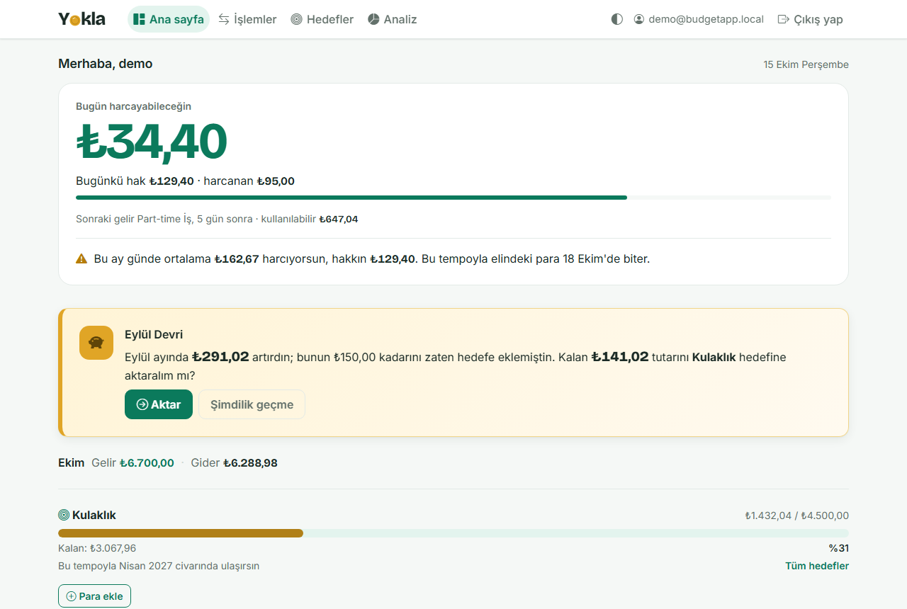
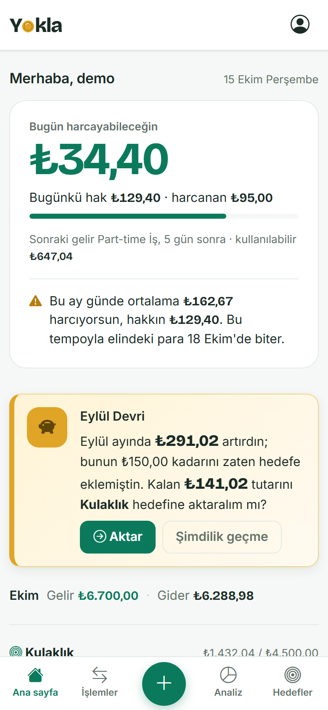
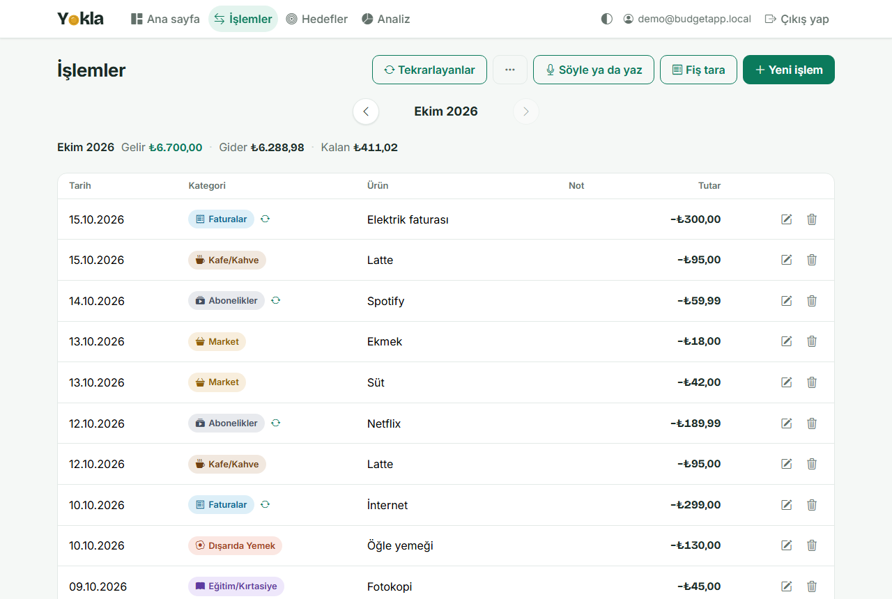
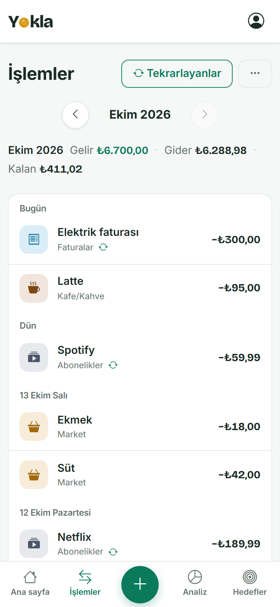
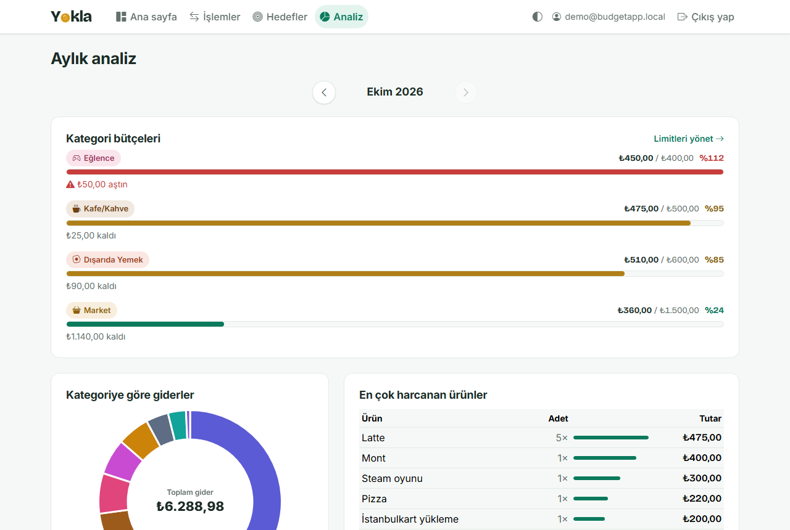
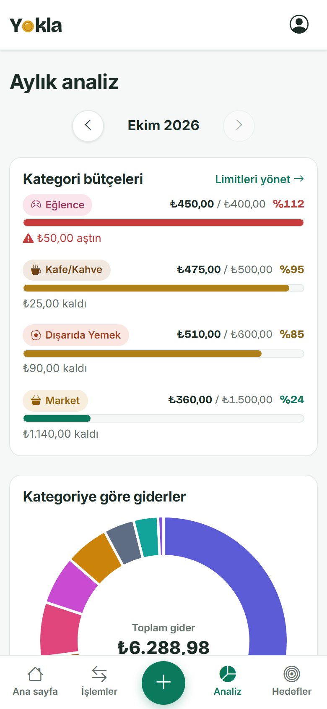
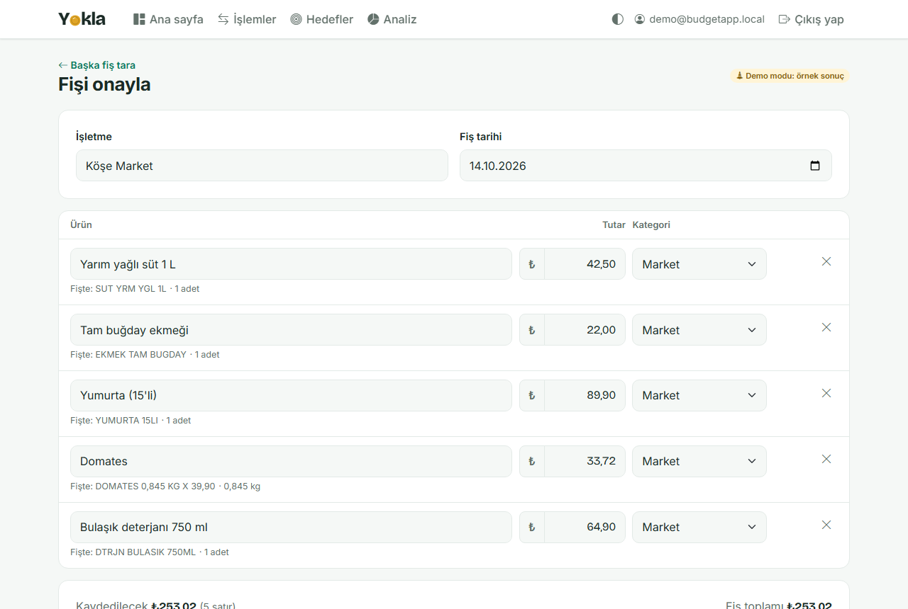
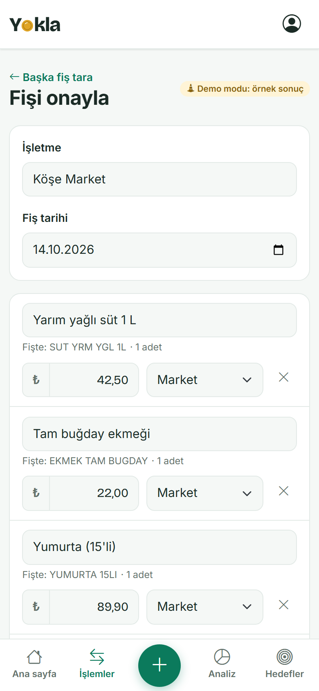
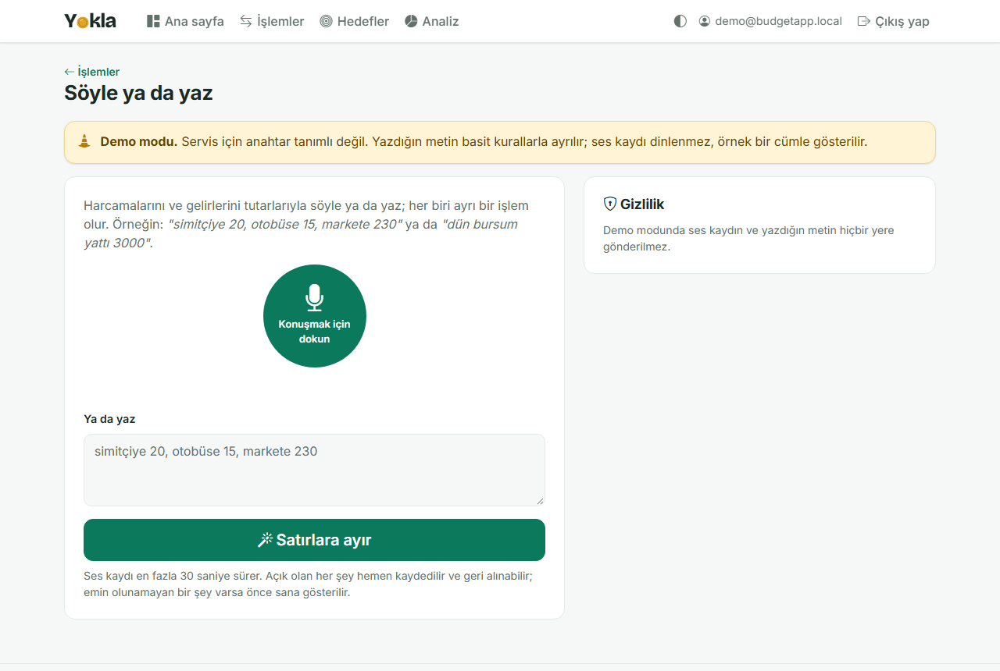
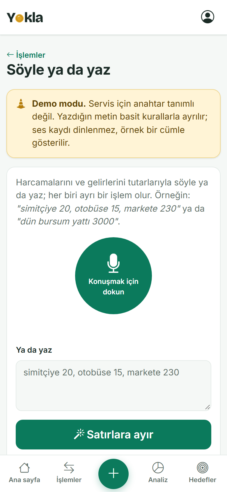

<picture>
  <source media="(prefers-color-scheme: dark)" srcset="docs/logo-dark.svg">
  <source media="(prefers-color-scheme: light)" srcset="docs/logo-light.svg">
  
</picture>

# Yokla (Turkish for "check your pockets")

**Cebini yokla.**

### Ay sonu gelmeden cebini yokla.
*Check your pockets before the month runs out.*

A simple income and expense tracker for everyone — students and people with a job alike. It records what comes in and what goes out, warns you the moment a purchase looks risky, explains where the month's money went, and tells you when you will reach a savings goal at your current pace.

> **Language note:** the user interface is in **Turkish** (currency TL, dates `dd.MM.yyyy`, `tr-TR` culture). The app is designed for **anyone in Turkey who wants to keep track of their money, students and employees included** — the default income categories cover salary, freelance work, part-time jobs, KYK scholarships and family support. Code, identifiers and commit messages are in English.

## Features

- **Income and expense tracking** — amount, category, date, optional item name and note. List, edit and delete, with a month picker (previous / next month) and per-month income, expense and balance totals. Future-dated entries are rejected.
- **Receipt scanning** — take a photo of a shop receipt (the phone's camera opens directly) and Google Gemini reads it: shop, date, every line with a readable product name ("SUT YRM YGL" → "Yarım yağlı süt"), amount and a suggested category, and the receipt total. You check the lines in an editable table, drop the ones you do not want, and each confirmed line is saved as its own expense. The photo is shrunk in the browser, sent once and never stored. A warning appears when the lines do not add up to the total or when the same receipt seems to be saved already; a discount on the whole receipt is spread over the lines. See [Receipt scanning setup](#receipt-scanning-setup).
- **Say or type ("Söyle ya da yaz")** — say "simitçiye 20, otobüse 15, markete 230" into the microphone or type it, and it becomes three separate transactions with categories (income too: "dün bursum yattı 3000"). The recording is sent to Google Gemini as audio (no speech-to-text in the browser) and never stored. Clear lines are saved at once with an "undo / edit" message; anything the reader was unsure about (a missing amount, an unknown category, an old date) opens a confirmation screen first. The instant warnings run on these lines too. See [docs/rules.md](docs/rules.md) section 10.
- **CSV export** — download the shown month as a CSV file that opens correctly in Turkish Excel (UTF-8 with BOM, `;` separator, decimal comma; columns Tarih, Tür, Kategori, Ürün, Not, Tutar). Text that a spreadsheet would run as a formula is defused.
- **Daily allowance** — a card at the top of the dashboard answers "how much can I spend today?": the money on hand, minus the recurring expenses still due before the next recurring income, divided by the days until that income. It is measured at the start of the day, so spending during the day uses the allowance up without shrinking it, and whatever is left (or overspent) carries into tomorrow's. When this month's daily pace would use the available money up before the next income, the card says on which day ("at this pace your money runs out on 27 October").
- **Recurring transactions** — define your salary, rent, subscriptions and other monthly items once; the app adds the transaction on its due day (day 31 falls on the last day of shorter months). Definitions can be paused, resumed, edited or deleted, and a "repeat every month" switch on the new-transaction form creates one from a regular entry. There is no background job: due items are generated when the user opens a page, at most once per month.
- **Savings goal bar** — create a goal (e.g. headphones, 4.500 TL) and watch the bar fill. A "Para ekle" (add money) button on each unfinished goal puts money in by hand; amounts above what the goal still needs are reduced automatically.
- **Month-end carry-over** — in a new month the home page offers to move last month's surplus to the goal with one click (never more than the goal still needs). Money you already added by hand that month is not moved a second time. A month can only be closed once.
- **Instant warnings** — right after an expense is saved, the page shows warnings based on five rules: an unusually large single expense, too much "unnecessary" spending, a category running well ahead of last month, a projected negative month-end balance, and a category budget that is nearly used up or exceeded.
- **Category budgets** — set a monthly limit on an expense category (e.g. coffee, 500 TL). You are warned once when you pass 80% and once when you pass 100% of it each month, and the analysis page shows a progress bar for every limit. Limits are managed on their own small page.
- **Monthly analysis** — Chart.js pie chart by category, the 10 most expensive items, change versus the previous month, and 2–3 rule-based tips.
- **Forecast** — projected month-end balance and "at this pace you reach your goal around *month year*". Recurring income and expenses that are still to come this month are included, so a salary due on the 20th no longer makes the first half of the month look like a deficit.
- **Accounts** — registration and login with ASP.NET Core Identity; every user only ever sees their own data. Five wrong passwords in a row lock the account for five minutes. Only the app's own sign-in, sign-up and sign-out pages exist: the other pages of the Identity UI package (account management, password reset, two-factor, "delete personal data") are closed and answer 404.
- **Dark theme** — follows the operating system by default; a switch in the navbar chooses light, dark or system and the choice is remembered in the browser.

The exact formulas and thresholds are documented in [docs/rules.md](docs/rules.md) and the data model in [docs/model.md](docs/model.md) (both written in Turkish).

## Screenshots

The demo account on 15 October 2026 (the date is pinned with `Clock:Today`, see [Demo account](#demo-account)). GitHub shows the light or the dark theme to match yours; every image exists in both, in [docs/screenshots/](docs/screenshots/).

<table>
<tr><td colspan="2"><b>Home</b> — today's allowance with the pace line, the month-end carry-over card, the month and the goal</td></tr>
<tr><td valign="top"><picture><source media="(prefers-color-scheme: dark)" srcset="docs/screenshots/home-desktop-dark.png"></picture></td><td valign="top"><picture><source media="(prefers-color-scheme: dark)" srcset="docs/screenshots/home-phone-dark.png"></picture></td></tr>
<tr><td colspan="2"><b>Transactions</b> — month picker, totals and the list</td></tr>
<tr><td valign="top"><picture><source media="(prefers-color-scheme: dark)" srcset="docs/screenshots/transactions-desktop-dark.png"></picture></td><td valign="top"><picture><source media="(prefers-color-scheme: dark)" srcset="docs/screenshots/transactions-phone-dark.png"></picture></td></tr>
<tr><td colspan="2"><b>Analysis</b> — category budgets in all three colours, spending by category, most bought items</td></tr>
<tr><td valign="top"><picture><source media="(prefers-color-scheme: dark)" srcset="docs/screenshots/analysis-desktop-dark.png"></picture></td><td valign="top"><picture><source media="(prefers-color-scheme: dark)" srcset="docs/screenshots/analysis-phone-dark.png"></picture></td></tr>
<tr><td colspan="2"><b>Receipt confirmation</b> — lines read from a receipt, ready to check (demo reader)</td></tr>
<tr><td valign="top"><picture><source media="(prefers-color-scheme: dark)" srcset="docs/screenshots/receipt-review-desktop-dark.png"></picture></td><td valign="top"><picture><source media="(prefers-color-scheme: dark)" srcset="docs/screenshots/receipt-review-phone-dark.png"></picture></td></tr>
<tr><td colspan="2"><b>Söyle ya da yaz</b> — say or type what you spent</td></tr>
<tr><td valign="top"><picture><source media="(prefers-color-scheme: dark)" srcset="docs/screenshots/quick-entry-desktop-dark.png"></picture></td><td valign="top"><picture><source media="(prefers-color-scheme: dark)" srcset="docs/screenshots/quick-entry-phone-dark.png"></picture></td></tr>
</table>

## Tech stack

- ASP.NET Core MVC on **.NET 10**
- Entity Framework Core with **SQLite** (a single file, no database server)
- ASP.NET Core Identity for authentication
- Razor views, Bootstrap, and [Chart.js](https://www.chartjs.org/) 4 (vendored under `wwwroot/lib/chartjs`, so the app works offline)
- xUnit for tests

## Architecture

The product is called Yokla; in the code it keeps its working name, BudgetApp (project, namespaces, folders).

```
src/BudgetApp
├── Models/          Entities (Category, Transaction, Goal, GoalContribution, MonthClose, ReceiptScan) and view models
├── Data/            ApplicationDbContext, EF Core migrations, development demo-data seeder
├── Services/        All business logic: transactions, CSV export, recurring definitions, budgets, goals, month close, warnings, analysis, forecast, daily allowance, receipt reading (Services/Receipts), say or type (Services/QuickEntry), the shared Gemini client (Services/Gemini)
├── Infrastructure/  The filter that generates due recurring transactions before each request
├── Controllers/     Thin MVC controllers: read the request, call a service, return a view
├── Views/           Razor views (Turkish UI)
├── Areas/Identity/  Login, register and logout pages
└── Localization/    Turkish Identity and model-binding messages
tests/BudgetApp.Tests    xUnit tests for the services (in-memory SQLite with the real schema)
docs/                    Data model and business rules
```

Design decisions worth knowing:

- **Money is always `decimal`** (`decimal(18,2)` in the database), never `double` or `float`.
- **Controllers stay thin.** Calculations live in `Services`, each of which has tests. Services take "today" as a parameter, so date-dependent rules are tested with a fixed clock.
- **Per-user isolation.** Every query filters by `UserId`; asking for someone else's record behaves like "not found".
- **An LLM only reads input.** Receipt scanning and "Söyle ya da yaz" are the only places an external API is used, and only to turn a photo or a sentence into lines; anything doubtful is shown to the user before it is saved, and saved lines can be undone. The warnings, tips and forecasts are plain, deterministic rules, so every number can be traced back to the data.
- **The readers are replaceable.** `IReceiptParser` and `IQuickEntryParser` hide the provider; the Gemini readers share one `GeminiClient` that calls the REST API with plain `HttpClient` (no SDK package) and a JSON schema for the answer. Their tests use canned HTTP answers and never call the real API.
- **One bold thing per page.** The home page has a single raised surface and a single big number, today's allowance; everything else is a quiet section. Amounts use [Bricolage Grotesque](https://fonts.google.com/specimen/Bricolage+Grotesque) (SIL OFL, bundled under `wwwroot/fonts`) with tabular figures; text stays in Inter. Expense amounts are not red: red is kept for problems. On phones a bottom tab bar replaces the hamburger menu. The design guide is [docs/design-brief.md](docs/notes/design-brief.md).
- **Light and dark theme from one set of variables.** `wwwroot/css/site.css` defines every colour as a CSS variable and redefines them under Bootstrap 5.3's `[data-bs-theme="dark"]`. A few lines of inline script in `<head>` set the theme before the first paint, so the page never flashes in the wrong theme. Each category has a light and a dark tone in `Models/CategoryStyle.cs`; the analysis chart repaints itself when the theme changes.

## Getting started

Requirements: the [.NET 10 SDK](https://dotnet.microsoft.com/download) and Git.

```bash
git clone <repository-url>
cd <repository-folder>

dotnet run --project src/BudgetApp
```

The app listens on `http://localhost:5277` (`dotnet run --project src/BudgetApp --launch-profile https` adds `https://localhost:7138`; the microphone of "Söyle ya da yaz" needs HTTPS or localhost). In the **Development** environment (the default when launched through `dotnet run`) it creates the SQLite database file, applies the migrations and adds a demo account, so no extra setup is needed.

To manage the database manually instead:

```bash
dotnet tool install --global dotnet-ef        # once
dotnet ef database update --project src/BudgetApp
```

Run the tests:

```bash
dotnet test
```

They cover the services (in-memory SQLite with the real schema) and, through `Microsoft.AspNetCore.Mvc.Testing`, the whole app over HTTP: sign-in only pages, antiforgery on every POST, one user never reaching another's data, the closed Identity pages and the lockout. Gemini is never called; its readers are tested against canned HTTP answers.

Two more checks live in [tools/](tools/) and need no packages:

```bash
node tools/js/run-all.js                                          # the browser scripts (theme switch, receipt and quick entry screens) against a fake DOM; Node 18+
powershell -ExecutionPolicy Bypass -File tools/contrast.ps1 -OnlyFailures   # WCAG contrast of the colour pairs in both themes; Windows PowerShell or pwsh
```

Both exit with a non-zero code when something fails.

### Receipt scanning setup

Receipt scanning needs a Gemini API key from [Google AI Studio](https://aistudio.google.com/). Keep it out of the code and out of `appsettings.json`:

```bash
dotnet user-secrets set "Gemini:ApiKey" "<your key>" --project src/BudgetApp
```

In production, set the environment variable `Gemini__ApiKey` instead. The same key is used by "Söyle ya da yaz". Without a key, the Development environment runs both in **demo mode** (a few made-up receipts; typed sentences split by simple rules, recordings answered with a sample sentence; clearly labelled); in any other environment both features are switched off and their buttons are hidden.

To check how Gemini handles a real recording (for example an iPhone Voice Memos `.m4a`, since the microphone in the browser needs HTTPS), run in Development:

```bash
dotnet run --project src/BudgetApp -- quick-entry-test recording.m4a
```

It sends the file to the real reader, prints what was heard, the lines and what the app would do, and saves nothing.

Settings in `appsettings.json`:

| Setting | Default | Meaning |
| --- | --- | --- |
| `Gemini:Model` | `gemini-3.8-flash` | Model used to read receipts |
| `Gemini:TimeoutSeconds` | `60` | How long one receipt may take |
| `Gemini:ThinkingLevel` | `low` | How much the model thinks before answering (`low`, `medium`, `high`; `low` is the lowest `gemini-3.8-flash` accepts). Empty = the model's default |
| `Gemini:RetryDelaysSeconds` | `[1, 2]` | When the model is overloaded (HTTP 503) the request is sent again after these waits, each a little longer; all tries together stay within `TimeoutSeconds`. Other errors are not retried. Empty = no retry |
| `Gemini:FallbackModel` | `gemini-3.5-flash-lite` | Asked once when `Gemini:Model` is still overloaded after the retries, within the same timeout; it takes pictures, audio and a JSON schema. The log says when it was used. Empty = no fallback |
| `Receipts:DailyLimitPerUser` | `10` | Receipts one user may scan per day (attempts that got no answer, such as timeouts, do not count) |
| `Receipts:DailyLimitTotal` | `300` | Requests the whole app may send per day, receipts and quick entries together (the free quota belongs to the one key) |
| `Receipts:MaxUploadBytes` | `4000000` | Largest accepted photo |
| `Receipts:MaxImageEdge` | `2048` | The browser shrinks photos to this many pixels on the longer side |
| `QuickEntry:DailyLimitPerUser` | `30` | Quick entries (spoken or typed) one user may send per day, separate from receipts |
| `QuickEntry:MaxRecordingSeconds` | `30` | The browser stops recording after this long |
| `QuickEntry:MaxAudioBytes` | `2000000` | Largest accepted recording |
| `QuickEntry:MaxTextLength` | `500` | Longest accepted typed sentence |

Check the free-tier limits of your key in AI Studio and set the two daily limits below them.

Every Gemini request is logged with its duration, HTTP status, finish reason and token counts (prompt, answer, thinking), e.g. `Gemini gemini-3.8-flash answered HTTP 200 in 6421 ms (thinking low; image 412 KB; finish STOP; tokens: prompt 1290, answer 210, thinking 340)`. The API key is never logged. The log goes to the console of `dotnet run`.

> **Before you offer receipt scanning to others, read the [Gemini API terms](https://ai.google.dev/gemini-api/terms).** In short, as of October 2026:
> - **Free tier data use:** on the unpaid tier Google may use the submitted photos, recordings, sentences and the answers to improve its products, and human reviewers may read them. Google asks not to send sensitive or personal information. The upload and "Söyle ya da yaz" pages say this, suggest covering card numbers and names on the receipt, and remind that other people's voices may end up in a recording.
> - **Age:** the API may only be used by people 18 or older, and not in apps aimed at or likely to be used by people under 18.
> - **EU, UK and Switzerland:** apps offered to users there may only use the paid tier.

## Demo account

In Development only, a demo user is created on first start with about three months of realistic data. The demo persona happens to be a university student (one example of a user, not the target audience): KYK scholarship and family support, rent, bills, subscriptions, groceries with item names, coffee, transport and entertainment, monthly limits on coffee, eating out, entertainment and groceries (mid-month the analysis page shows all three bar colours), a "Kulaklık" (headphones) goal, and month-close records for the two oldest months. The most recent month is deliberately left open so the carry-over card shows up on the home page.

| | |
| --- | --- |
| E-mail | `demo@budgetapp.local` |
| Password | `Demo123!` |

The monthly items (rent, scholarship, family support, bills, subscriptions, part-time pay) are set up as recurring definitions, so they keep arriving on their own after the first start. The dates are generated relative to the current day, so the data always looks fresh. The demo account is never created outside the Development environment.

To see the demo on a particular day (for example the 15th, when the pace line and all three budget colours show up), pin the date in Development; it is refused in any other environment:

```bash
dotnet run --project src/BudgetApp -- --Clock:Today=2026-10-15
```

Delete `src/BudgetApp/app.db` first so the demo data is generated around that date.

## If you deploy it

The project is shared as code and has not been hardened for a public server. Before putting it online:

- **Time zone.** Every "today" is read from the server's clock (`DateTime.Today`). On a server in UTC a Turkish user between 00:00 and 03:00 would get yesterday: today's date is refused as "in the future", the month-end card and the daily allowance move three hours late. Run the server in Turkish time (for example the environment variable `TZ=Europe/Istanbul` on Linux), or give the app's one clock (`AppClock`, registered in `Program.cs`) a `TimeProvider` whose `LocalTimeZone` is `Europe/Istanbul`.
- **Abuse and rate limits.** Anyone can register, and five wrong passwords only lock an account for five minutes. Add ASP.NET Core's built-in rate limiter (no extra package) to sign-in, sign-up, receipt reading and quick entry; otherwise a few accounts are enough to use up the shared daily Gemini limit (and, on the paid tier, money).
- **Security headers.** Add `Content-Security-Policy`, `X-Content-Type-Options: nosniff`, `Referrer-Policy` and `Permissions-Policy: microphone=(self), camera=(self)`; `X-Frame-Options` is only sent on pages with a form today.
- **Data protection keys and database.** The keys that protect the sign-in cookie and TempData are kept in memory by default in a container, so every restart signs everyone out: persist them (`AddDataProtection().PersistKeysToFileSystem(...)`). Outside Development the database is not migrated on start: run `dotnet ef database update` (or a migration bundle) as part of the deployment, and keep `app.db` on a persistent volume.
- **Gemini terms.** Read the notes under [Receipt scanning setup](#receipt-scanning-setup): age limit, free-tier data use, paid tier for the EU, UK and Switzerland.

## Future improvements

- **More receipt readers** — another `IReceiptParser` (e.g. a different LLM provider or on-device OCR) can be added without touching the pages.
- **LLM-written tips** — keep all numbers computed by the services and let an LLM only phrase the advice sentences more naturally.
- **Mobile app** — a companion app for entering expenses on the go.
- **Account management** — changing the password or e-mail and deleting the account. The Identity UI package's own pages are closed on purpose: they are in English, outside the app's design, and its "delete personal data" removes only the login while the transactions, goals and other data stay. The app's own version should delete all of the user's data in one database transaction.
- **E-mail confirmation and password reset** — needs an e-mail sender; accounts are active immediately today.
- **Push notifications** for warnings and month-end reminders.
- **Bank integration** to import transactions automatically.
- **Investment module** for longer-term goals.

## License

[MIT](LICENSE). The bundled libraries and fonts keep their own licenses (see the LICENSE files under src/BudgetApp/wwwroot/lib and src/BudgetApp/wwwroot/fonts).
